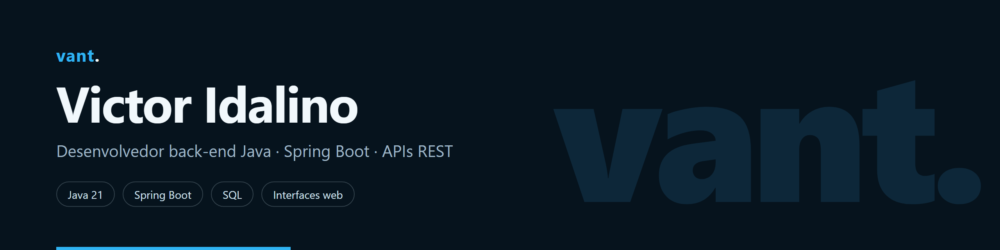
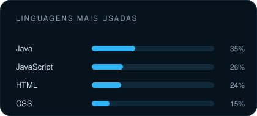

  

  <code>&gt;_ construindo back-end Java, um endpoint por vez</code>

  
  

## Sobre mim

Comecei a programar em novembro de 2025, período em que montei a base da minha suíte de projetos. Pausei os estudos no início de 2026 e retomei em outubro do mesmo ano, agora com foco em conquistar a primeira vaga como desenvolvedor full stack.

Na prática, construí sete projetos completos — do jogo em Java puro ao banco com API REST — cada um com regras de negócio próprias, testes automatizados e interface web publicada. Também desenvolvi o site institucional de uma transportadora, com identidade visual, vídeo de fundo e foco em conversão.

Hoje estudo **Spring Data JPA, SQL, testes de integração e boas práticas de API REST**.

## Tecnologias

  

## Projetos

| Projeto | O que faz | Stack | Demo |
| --- | --- | --- | --- |
| **[vant.bank](https://github.com/idalinosou/vant.bank)** | Contas, depósitos e transferências com validação de saldo e 25 testes de integração | Java · Spring Boot · JPA | [abrir](https://idalinosou.github.io/vant.bank/) |
| **[vant.store](https://github.com/idalinosou/vant.store)** | Loja com catálogo, carrinho e painel administrativo em duas interfaces | Java · Spring Boot · JPA | [abrir](https://idalinosou.github.io/vant.store/) |
| **[vant.finance](https://github.com/idalinosou/vant.finance)** | Controle de receitas e despesas por categoria com dashboard e gráficos | Java · Spring Boot · JPA | [abrir](https://idalinosou.github.io/vant.finance/) |
| **[vant.logistica](https://github.com/idalinosou/vant.logistica)** | Gestão de entregas, veículos e status de rota em painel operacional | Java · Spring Boot · JPA | [abrir](https://idalinosou.github.io/vant.logistica/) |
| **[vant.tasks](https://github.com/idalinosou/vant.tasks)** | API de tarefas com CRUD completo, validação de entrada e filtros | Java · Spring Boot · JPA | [abrir](https://idalinosou.github.io/vant.tasks/) |
| **[vant.game](https://github.com/idalinosou/vant.game)** | Jogo com regras de negócio isoladas da interface e testes em JUnit | Java 21 · JUnit | [abrir](https://idalinosou.github.io/vant.game/) |
| **[vant.portfolio](https://github.com/idalinosou/Portfolio)** | Portfólio com a linha do tempo dos estudos e os projetos publicados | HTML · CSS · JS | [abrir](https://idalinosou.github.io/portfolio/) |

Trabalhos para clientes: **[Decargo Express](https://idalinosou.github.io/decargo.express/)** — site institucional de transportadora com oito páginas, identidade visual própria e vídeo de fundo.

## GitHub em números

  
  

  Cards gerados por um workflow deste repositório a partir da API do GitHub.

 

  <a href="https://idalinosou.github.io/portfolio/"><b>vant.</b></a>

